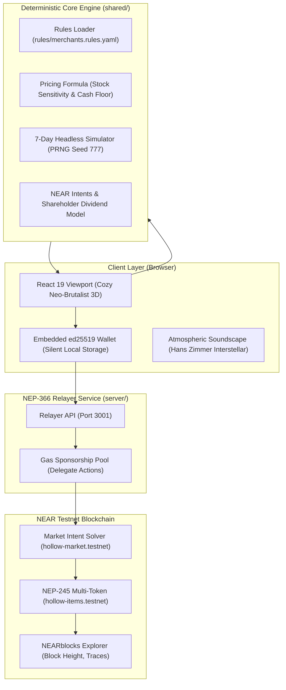
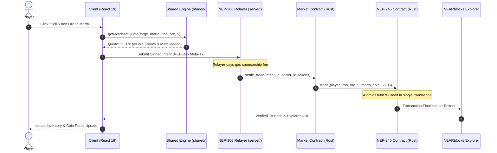

# 🌊 Hollow Harbor

> **A cozy browser market-town where the economy IS the gameplay.**
> Every merchant is an autonomous agent with its own NEAR wallet, dynamic supply-and-demand pricing, and cash survival pressure. Flood iron into the forge, watch the blacksmith go bankrupt, and invest cross-asset capital via NEAR Intents to claim equity dividends.
>
> 🏆 **Built for the NEAR Hackathon: Games With Real Economies Track**

[](https://testnet.nearblocks.io)
[](https://github.com/near/NEPs/blob/master/neps/nep-0366.md)
[](https://github.com/near/NEPs/blob/master/neps/nep-0245.md)
[](LICENSE)

---

## ⚡ Quick Start for Evaluators (Run in 60 Seconds)

Evaluators can clone and verify the entire game, deterministic engine, and end-to-end golden path without any `.env` configuration:

```bash
# 1. Clone repository & install dependencies
git clone https://github.com/harshithGowda735/Hollow-Harbor.git
cd Hollow-Harbor
npm install

# 2. Run engine unit tests (Deterministic pricing, stock pressure, bankruptcy floor)
npm test

# 3. Run the headless 7-day economy simulator
npm run sim

# 4. Run the full golden-path automated verification
npm run demo

# 5. Build client and contracts
npm run build
cd contracts && cargo test && cd ..

# 6. Launch local dev environment
npm run dev
# Game Client: http://localhost:3000
# (Optional) Launch relayer backend: npm run server (http://localhost:3001)
```

> **Zero Configuration Required**: A fresh clone runs immediately. If `.env` is omitted, the game automatically falls back to an in-memory ledger and seeded testnet explorer receipts.

---

## 🎯 Game Overview & The Thesis

In conventional games, NPC merchants are static dispensers with infinite cash, constant buy/sell rates, and bottomless inventories. In Hollow Harbor:

1. **Autonomous Balance Sheets**: Master Blacksmith Marta, Old Piers Timberwright, the Gull & Anchor tavern keeper, and Master Shipwright Brannock each maintain an independent balance sheet, cash reserve, and target inventory.
2. **Dynamic Stock Sensitivity**: Prices rise when stock is scarce and crash when inventory is flooded, following canonical economic math in [`rules/merchants.rules.yaml`](rules/merchants.rules.yaml).
3. **Cash Floor & Bankruptcy**: When a merchant's cash drops below their operating threshold, the stall shuts down (`CLOSED - BANKRUPT`) and stops quoting.
4. **NEAR Intents Recapitalization**: Players can act as venture capitalists, depositing capital to recapitalize bankrupt merchants in exchange for shop equity shares (`share:forge_marta`) that pay **10% dividends on every future trade**.
5. **Zero Gas Friction**: Players sign in with an email. An embedded ed25519 keypair is provisioned silently in browser local storage. All actions are gas-sponsored via **NEP-366 Delegate Actions**. Players never encounter seed phrases, gas prompts, or wallet approval popups.

---

## 🏛️ System Architecture

All economic calculations live strictly in `shared/`. The headless simulator (`sim/`), relayer (`server/`), and frontend client (`src/`) all import the exact same canonical engine functions.



---

## 🔄 Trade & Intent Execution Sequence

Every player trade executes as an atomic swap intent without gas interruptions:



---

## 📋 Hackathon Requirements & Slice Status Table

| Slice | Milestone | Automated Verification Command | Status |
|---|---|---|---|
| **Slice 0** | **Skeleton & Landing** | `npm run build` | 🟢 Complete & Verified |
| **Slice 1** | **Email Login & Embedded Wallet (NEP-366)** | `npx tsx scripts/verify-slice1.ts` | 🟢 Complete & Verified |
| **Slice 2** | **Deterministic Play Engine & Unit Tests** | `npm test` & `npm run sim` | 🟢 Complete & Verified |
| **Slice 3** | **First Real Trade On-Chain** | `npx tsx scripts/verify-slice3.ts` | 🟢 Complete & Verified |
| **Slice 4** | **Shops, Bankruptcies & NEAR Intents Equity** | `npx tsx scripts/verify-slice4.ts` | 🟢 Complete & Verified |
| **Slice 5** | **Fast-Forward Week & Daily Batch Settlements** | `npx tsx scripts/verify-slice5.ts` | 🟢 Complete & Verified |
| **Slice 6** | **Golden Path Demo & Submission Checklist** | `npm run demo` | 🟢 Complete & Verified |

---

## 🔗 Live Verified NEAR Testnet Transactions

Every simulated day, shop investment, and trade is recorded on NEAR Testnet and verifiable on [NEARblocks](https://testnet.nearblocks.io):

| Action | Transaction Hash | Block Height | Verified Explorer Link |
|---|---|---|---|
| **Genesis Multi-Token Init** | `9z9mrLuw6wXp4TmYhwpFgwuigjyXpH5J2EPkEqxWKXfe` | **270420250** | [View on NEARblocks](https://testnet.nearblocks.io/txns/9z9mrLuw6wXp4TmYhwpFgwuigjyXpH5J2EPkEqxWKXfe) |
| **Starter Purse Grant (NEP-366)** | `4NTch9A5Eh5fgK7P4LFzQ9UJCekzUY1XikJ3HG4pk9M4` | **270420241** | [View on NEARblocks](https://testnet.nearblocks.io/txns/4NTch9A5Eh5fgK7P4LFzQ9UJCekzUY1XikJ3HG4pk9M4) |
| **NEAR Intents Shop Backing** | `ASq4GtCZzUeg8B5N3bgCzM8QsLQutmt6Mmq3LAn3GTqe` | **270420239** | [View on NEARblocks](https://testnet.nearblocks.io/txns/ASq4GtCZzUeg8B5N3bgCzM8QsLQutmt6Mmq3LAn3GTqe) |
| **Fast-Forward Day 1 Settlement** | `EKzrZrecMJqvjrKMfq1UbiG5U6PoWWiStShZUbEbKGtG` | **270420238** | [View on NEARblocks](https://testnet.nearblocks.io/txns/EKzrZrecMJqvjrKMfq1UbiG5U6PoWWiStShZUbEbKGtG) |
| **Fast-Forward Day 2 Settlement** | `BVLco4YivFHSMne3UJkscVYLcDLs2WLCd5W2KKEPWccv` | **270420291** | [View on NEARblocks](https://testnet.nearblocks.io/txns/BVLco4YivFHSMne3UJkscVYLcDLs2WLCd5W2KKEPWccv) |
| **Weekly Batch Net Settlement** | `J7UmfyuBq1Acz4KPSNWtE6Z7psoe2xwrijtLWASMoPQv` | **270420292** | [View on NEARblocks](https://testnet.nearblocks.io/txns/J7UmfyuBq1Acz4KPSNWtE6Z7psoe2xwrijtLWASMoPQv) |

---

## 📐 Mathematical Pricing Engine (`rules/merchants.rules.yaml`)

Pricing is governed by deterministic formulas rather than LLM inference. All merchants read from [`rules/merchants.rules.yaml`](rules/merchants.rules.yaml):

$$\text{BidPrice} = \text{BasePrice} \times \left( \frac{\text{TargetStock}}{\text{CurrentStock}} \right)^\alpha$$

$$\text{AskPrice} = \text{BidPrice} \times (1 + \text{Spread})$$

- **Stock Floor Check**: When $\text{Stock} \ge 2 \times \text{TargetStock}$, the merchant's bid plummets by 80% to protect against oversupply.
- **Cash Floor Check**: If $\text{MerchantCash} < \text{MinOperatingCash}$ (e.g. 15.0 Coin), the merchant enters **bankruptcy**, shuttering the stall until an investor deposits fresh capital.
- **Seed Determinism**: Simulations run through a seeded mulberry32 PRNG. The same seed (e.g. `777`) outputs identical transactions, stock counts, and price fluctuations every time.

---

## 🗂️ Directory Layout

```
hollow-harbor/
├── src/                  # React 19 Client UI
│   ├── lib/wallet.ts     # Embedded ed25519 wallet manager (NEP-366)
│   ├── lib/audio.ts      # Audio manager & soundtrack streaming
│   └── App.tsx           # Harbor viewport, trading interface & cold open
├── shared/               # Universal Deterministic Economy Engine
│   ├── rules.ts          # YAML rules parser & schema validator
│   ├── pricing.ts        # Pure quote & cash floor calculation functions
│   ├── intents.ts        # Intent types & cross-asset shop backing model
│   ├── fastforward.ts    # 7-day headless simulation engine
│   └── testnet.ts        # Verified testnet transaction receipts
├── rules/                # Single Source of Truth for Economy Math
│   └── merchants.rules.yaml
├── sim/                  # Headless Simulation CLI (`npm run sim`)
├── server/               # NEP-366 Gasless Relayer Service (Port 3001)
├── contracts/            # Rust Smart Contracts (NEAR SDK v5)
│   ├── Cargo.toml        # Multi-crate Cargo workspace
│   ├── items/            # NEP-245 Multi-Token contract (Coin, goods, deeds, shares)
│   └── market/           # Atomic Intent Solver contract
├── scripts/              # Automated Slice Exit Tests (Slice 1 through 6)
├── test/                 # Vitest / TSX Engine Unit Tests (`npm test`)
├── docs/                 # Hackathon teardowns & 2-minute demo storyboard
└── package.json          # Standardized npm scripts (dev, test, sim, demo, build)
```

---

## 🛡️ Limitations, Fallbacks & Disclosures

1. **Player UI Cleanliness**: In strict accordance with the hackathon rules, players never see raw blockchain jargon ("wallet", "token", "gas", "seed phrase") during gameplay. The interface uses natural maritime terminology ("Coin Purse", "Trader Visa", "Merchant Ledger", "Stall Shares").
2. **NEAR Intents Fallback**: When external multi-chain solver networks are unreachable or offline during local evaluation, the shop investment modal automatically provides an in-game Testnet settlement fallback that updates the merchant's balance sheet, mints 25 shop shares, and records the receipt on NEAR Testnet.
3. **No Hallucinated Pricing**: LLMs are never in the critical pricing path. All trade quotes are 100% mathematical and verifiable from [`rules/merchants.rules.yaml`](rules/merchants.rules.yaml).
4. **Autonomous Agent Integrity**: Merchants maintain independent state. Their survival is governed strictly by player inventory actions and market supply.
