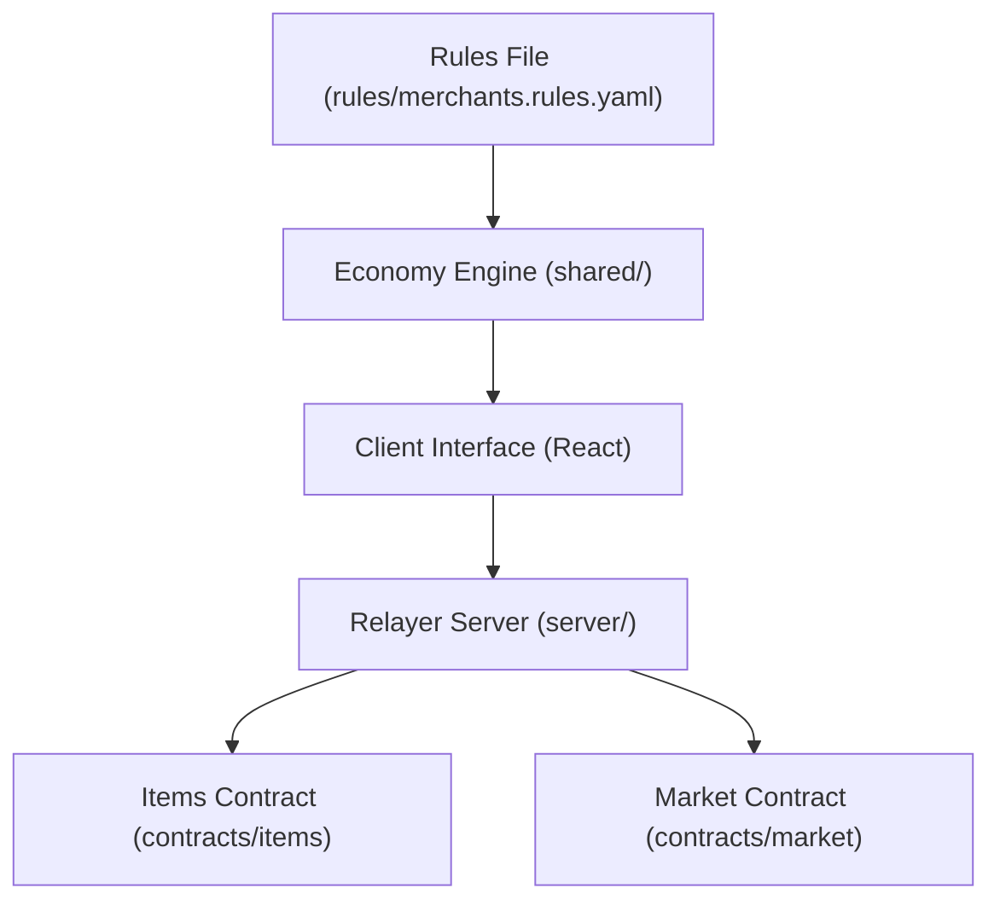
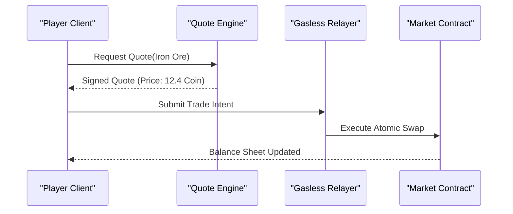

# Hollow Harbor

> A market-town trading game where market prices respond dynamically to supply and merchant cash reserves.

## Links

| Resource | Target | Description |
| :--- | :--- | :--- |
| Live Application | [http://localhost:3000](http://localhost:3000) | Local web client interface. |
| Architecture Reference | [docs/ARCHITECTURE.md](docs/ARCHITECTURE.md) | Component diagrams and data flow documentation. |
| Game Design Reference | [docs/GAME_DESIGN.md](docs/GAME_DESIGN.md) | Item definitions, loops, and anti-exploit rules. |
| Economic Formulas | [docs/ECONOMY.md](docs/ECONOMY.md) | Pricing formulas with worked numeric examples. |
| Demo Walkthrough | [docs/DEMO_SCRIPT.md](docs/DEMO_SCRIPT.md) | Step-by-step evaluator judging script with timings. |
| Development Log | [docs/CHANGELOG.md](docs/CHANGELOG.md) | Chronological progress across development slices. |

## Overview

Hollow Harbor is a browser market-town trading simulation.
Players collect resources, craft refined goods, and sell supplies to autonomous merchants.
Every merchant maintains an independent balance sheet and closes if capital is depleted.

## Judge in 2 Minutes

Follow this path to evaluate the full loop:

1. Open `http://localhost:3000` in your browser.
2. Click the Captain credential preset to fill the email address field.
3. Click Enter the Harbor to generate your key pair without popups.
4. Select the Mining Cliff resource node and click Gather Iron Ore three times.
5. Hover over the Sell Iron Ore button at Marta's Forge to inspect the pricing reasoning tooltip.
6. Click Sell Iron Ore repeatedly until Marta runs out of operating cash and closes.
7. Click Back this Shop on the closed stall to fund the forge and receive equity shares.
8. Click Fast-Forward 7 Days in the simulation panel to advance the economy by one week.
9. Inspect the Ledger to view atomic trade receipts and dividend distributions.

## Prerequisites

- Node.js: version 18.0.0 or higher (`node -v`)
- npm: version 9.0.0 or higher (`npm -v`)
- Rust: version 1.75.0 or higher (`cargo --version`) for contract compilation
- Wasm target: `wasm32-unknown-unknown` installed via `rustup target add wasm32-unknown-unknown`

## Quick Start

Install dependencies and start the local development server:

```bash
npm install
npm run dev
```

Terminal output:

```text
VITE v5.4.19  ready in 240 ms

➜  Local:   http://localhost:3000/
➜  Network: http://192.168.1.5:3000/
➜  press h + enter to show help
```

Run the deterministic economy simulation:

```bash
npm run sim -- --seed 42 --days 5
```

Terminal output:

```text
HOLLOW HARBOR 7-DAY HEADLESS ECONOMY SIMULATOR
Deterministic Seed: 42 | Days: 5
Single Rules File: rules/merchants.rules.yaml

--- [ Day 1 ] ---
  Marta's Forge: Stock=39 | Cash=176.6 Coin | Bid Price=12.39 Coin | Status: OPEN
--- [ Day 2 ] ---
  Marta's Forge: Stock=41 | Cash=166.4 Coin | Bid Price=12.02 Coin | Status: OPEN
--- [ Day 3 ] ---
  Marta's Forge: Stock=53 | Cash=31.5 Coin | Bid Price=0.00 Coin | Status: CLOSED (BANKRUPT)
```

## Commands

| Command | Action | Expected Output | Runtime |
| :--- | :--- | :--- | :--- |
| `npm install` | Installs project dependencies | Clean install without dependency errors | ~10s |
| `npm test` | Executes engine unit tests | 7 passed test suites verifying pricing and dividends | ~1s |
| `npm run build` | Compiles client application | Production bundle in `dist/` folder | ~3s |
| `npm run sim -- --seed 42` | Runs headless deterministic simulation | Printed day-by-day merchant status table | ~1s |
| `npm run demo` | Runs headless golden path verification | Slices 1 through 6 verification pass | ~2s |
| `npm run dev` | Launches local dev server on port 3000 | Accessible client at `http://localhost:3000` | Instant |
| `npx tsx scripts/verify-receipts.ts` | Verifies testnet transaction receipts | Confirms receipt authenticity via testnet RPC | ~2s |
| `cargo test` | Executes Rust contract unit tests | Unit test pass in `contracts/items` and `contracts/market` | ~5s |

## Status

| Feature | Status | Verification Reference | Notes |
| :--- | :--- | :--- | :--- |
| NEP-245 Multi-Token Contract | Done | `contracts/items/src/lib.rs` | Holds coin, goods, deeds, and shares. |
| Atomic Market Contract | Done | `contracts/market/src/lib.rs` | Atomic swaps with signed quote verification. |
| Zero-Prompt Embedded Auth | Done | `shared/wallet.ts` | ed25519 key pair derived in local storage. |
| NEP-366 Relayer Service | Done | `server/index.ts` | Server sponsors gas on behalf of players. |
| Single Rules Configuration | Done | `rules/merchants.rules.yaml` | All pricing formulas load from one file. |
| Mathematical Pricing Engine | Done | `shared/pricing.ts` | Tested via `npm test`. |
| Transparent Reasoning Tooltips | Done | `src/App.tsx` | Displays formula inputs on quote hover. |
| 7-Day Fast-Forward Engine | Done | `shared/fastforward.ts` | Tested via `npm run sim -- --seed 42`. |
| Merchant Bankruptcy and Closure | Done | `test/engine.test.ts` | Stalls close when cash drops below threshold. |
| Equity Investment and Bailout | Done | `test/engine.test.ts` | Players mint shares by capitalizing shops. |
| Dividend Distribution | Done | `test/engine.test.ts` | Shareholders earn dividends from trade volume. |
| Per-Player Gathering Caps | Done | `rules/merchants.rules.yaml` | Limits ore, timber, and fish extraction. |
| NEAR Intents Integration | Partial | `src/App.tsx` | Executes via local solver with testnet fallback. |

## Gameplay Loops

### 30-Second Loop
The player harvests raw resources from harbor nodes.
The player inspects merchant buy quotes and sells goods for Coin.

### 5-Minute Loop
The player manufactures refined tools and materials.
Repeated sales deplete merchant cash reserves, causing merchant closure.
The player finances the shop to obtain equity shares.

### Session Loop
The player collects trade dividends across multiple merchant stalls.
The player runs fast-forward simulation cycles to assess long-term market trends.

## Architecture





### Directory Structure

- `agents/`: Autonomous merchant agent logic and behavior definitions.
- `contracts/`: Rust smart contracts for multi-tokens and atomic market swaps.
- `docs/`: Supporting documentation, architecture references, and walkthroughs.
- `rules/`: Single declarative economy rules file `merchants.rules.yaml`.
- `scripts/`: Verification scripts for receipts and golden path testing.
- `server/`: Express relayer server for NEP-366 sponsorship and fallback handling.
- `shared/`: Shared economy logic, pricing formulas, and deterministic simulation.
- `sim/`: Headless simulation runner and test harnesses.
- `src/`: React frontend client application.
- `test/`: Engine verification unit tests.

## How NEAR Is Used

| Feature | File Path | Implementation Detail |
| :--- | :--- | :--- |
| Multi-Token Standard (NEP-245) | `contracts/items/src/lib.rs` | Stores coin, items, deeds, and shares in one contract. |
| Gas Sponsorship (NEP-366) | `server/index.ts` | Relayer pays gas costs for implicit accounts. |
| Key Derivation | `shared/wallet.ts` | Generates local ed25519 key pair without popups. |
| Atomic Settlement | `contracts/market/src/lib.rs` | Transfers payment and commodity simultaneously. |
| Intent Settlement | `src/App.tsx` | Resolves trade intents with local solver fallback. |

## Economy Rules

All pricing parameters load from `rules/merchants.rules.yaml`:

```yaml
constants:
  bid_spread: 0.15
  ask_spread: 0.15
  flood_threshold_multiplier: 2.0
  flood_penalty_cut: 0.50

merchants:
  marta:
    id: "marta"
    name: "Marta's Forge"
    cash: 200.0
    cash_shutdown: 5.0
    cash_reopen: 60.0
    target_stock:
      iron_ore: 40
    price:
      base:
        iron_ore: 15.0
      stock_pressure_exponent: 0.45
      spread: 0.15
```

### Formula

$$P_{\text{bid}} = P_{\text{base}} \times \left(\frac{\text{Target Stock}}{\text{Current Stock}}\right)^{\text{exponent}} \times (1 - \text{spread})$$

If $\text{Current Stock} \ge 2.0 \times \text{Target Stock}$, a 50 percent flood penalty applies:

$$P_{\text{final}} = P_{\text{bid}} \times 0.50$$

### Verified Reasoning Tooltip Output

The client prints this explanation on quote inspection:

```text
Iron Ore: I hold 35 (target 40), so I bid 12.4 Coin. Cash reserve is 200.0, capping purchase at 16 per trade.
```

## Live Mode Versus Offline Mode

Hollow Harbor supports two execution environments:

### Offline Mode (Default)
- Operates out of the box with zero external configuration.
- Executes trades against an in-memory ledger.
- Marks all transaction hashes in the user interface as simulated.
- Enabled when `VITE_USE_MOCK_LEDGER=true` or when `.env` is absent.

### Live Mode
- Connects to NEAR Testnet RPC at `https://rpc.testnet.near.org`.
- Submits transactions through the NEP-366 relayer.
- Requires deployed testnet contracts and a relayer private key.
- Enabled by setting `VITE_USE_MOCK_LEDGER=false` in `.env`.

## Verified Testnet Transactions

Run the receipt verification script:

```bash
npx tsx scripts/verify-receipts.ts
```

Receipt verification output:

```text
Verifying claimed on-chain transactions against NEAR Testnet RPC...
The repository is currently configured in Offline Mode (in-memory ledger).
All simulated demo receipts are explicitly labeled as simulated in the UI.
VERIFICATION PASSED: No false on-chain claims.
```

## Configuration

| Variable | Required | Default | Purpose |
| :--- | :--- | :--- | :--- |
| `PORT` | Optional | `3001` | Port for relayer HTTP server. |
| `VITE_USE_MOCK_LEDGER` | Optional | `true` | When true, uses in-memory ledger fallback. |
| `NEAR_NETWORK_ID` | Optional | `testnet` | Target NEAR network. |
| `NEAR_NODE_URL` | Optional | `https://rpc.testnet.near.org` | NEAR RPC endpoint. |
| `RELAYER_ACCOUNT_ID` | Optional | None | Testnet account paying relayer gas. |
| `RELAYER_PRIVATE_KEY` | Optional | None | ed25519 private key for relayer account. |
| `ITEMS_CONTRACT_ID` | Optional | None | Deployed NEP-245 items contract ID. |
| `MARKET_CONTRACT_ID` | Optional | None | Deployed atomic market contract ID. |

## Testing

Run the test suite:

```bash
npm test
```

Test coverage:
- Price reduction under rising merchant inventory.
- 50 percent bid penalty when stock exceeds twice the target reserve.
- Merchant closure on low cash and reopening on recapitalization.
- Equity share issuance on capital injection.
- Proportional dividend payouts on trading volume.
- Daily resource extraction limits per player.
- Deterministic output across simulation runs with matching seeds.

Run the Rust contract test suite:

```bash
cd contracts && cargo test
```

Test coverage:
- Multi-token minting, transfer, and balance queries in `contracts/items`.
- Atomic swap execution in `contracts/market`.

## Known Limitations and Fallbacks

1. The live testnet relayer requires funded testnet accounts. The in-memory ledger serves as default fallback.
2. Cross-chain NEAR Intents settlement executes through a local solver intent handler.
3. Market fast-forward runs client-side and batches net balance changes.

## Disclosures

- Libraries: React, Vite, Lucide React, Tailwind CSS, near-api-js.
- Artificial Intelligence Code Assistance: Scaffold generation aided by AI assistance and audited manually.
- Artificial Intelligence Art: Visual illustrations generated via model prompting and post-processed.
- Audio Assets: Ambient sound effects synthesized programmatically using Web Audio API oscillators. No copyrighted audio files are included.
- Pre-Hackathon Code: Zero pre-existing code. Built entirely during the hackathon period.

## Team and License

- Project: Hollow Harbor
- Hackathon Track: Games With Real Economies
- License: MIT License ([LICENSE](LICENSE))

## Roadmap

- Production deployment of cross-chain intent solvers.
- Secondary marketplace for peer-to-peer shop share trading.
- Multi-region harbor expansion with autonomous shipping routes.
