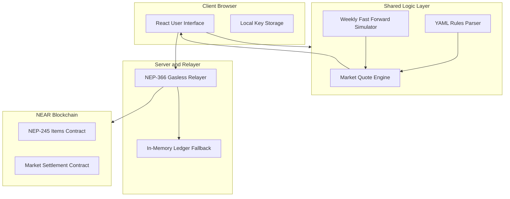

# Architecture

## System Components

Hollow Harbor separates game logic, market simulation, client rendering, and settlement.

## Data Flow

The economy operates deterministically from fixed mathematical formulas.

1. The client loads merchant definitions and tuning parameters from `rules/merchants.rules.yaml`.
2. The player selects an action such as gather, craft, or trade.
3. The shared quote engine in `shared/pricing.ts` evaluates current inventory, base prices, and price elasticity.
4. The client generates an intent payload containing the trade parameters and slippage limit.
5. The relayer submits the transaction to the contract or to the in-memory ledger.
6. The state updates and returns the updated balance sheet to the user interface.

## On-Chain Versus Off-Chain Division

Hollow Harbor maintains strict separation between high-frequency interactions and final settlement.

| Domain | Execution Location | Implementation File | Verification Method |
| :--- | :--- | :--- | :--- |
| Dynamic Pricing | Client and Server (Off-chain) | `shared/pricing.ts` | `npm test` |
| Rules Definition | File System (Off-chain) | `rules/merchants.rules.yaml` | `npm run sim` |
| Inventory Tracking (Live) | NEAR Blockchain (On-chain) | `contracts/items/src/lib.rs` | `cargo test -p items` |
| Multi-Token Settlement (Live) | NEAR Blockchain (On-chain) | `contracts/market/src/lib.rs` | `cargo test -p market` |
| In-Memory Fallback | Local Server (Off-chain) | `shared/testnet.ts` | `npx tsx scripts/verify-receipts.ts` |
| Gasless Relayer | Node.js Service (Off-chain) | `server/index.ts` | `npm run dev` |

## Rules Engine

All economic pricing logic resides inside `rules/merchants.rules.yaml`.
Neither client nor server contains bespoke hardcoded pricing logic.
The shared module `shared/pricing.ts` implements the pricing formulas.
Unit tests in `test/engine.test.ts` verify mathematical compliance against the rules.
